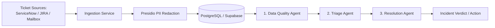

# Project Overview & Architecture Guide for AI Agents

Welcome to the **AMS Agentic Incident Management** repository.

> **CRITICAL DIRECTIVE FOR ALL AGENTS**:
> **DO NOT start reading every source code file across the repository.**
> Read this file first, along with the specific subsystem guide relevant to your task:
> - Backend / API / DB logic: [`backend/DEVELOPMENT.md`](backend/DEVELOPMENT.md)
> - Database scripts & migrations: [`backend/db/scripts/DEVELOPMENT.md`](backend/db/scripts/DEVELOPMENT.md) and [`backend/db/scripts/DQ_RULES_FEATURE.md`](backend/db/scripts/DQ_RULES_FEATURE.md)
> - Frontend / Next.js / UI: [`frontend/DEVELOPMENT.md`](frontend/DEVELOPMENT.md) and [`frontend/frontend-guidelines.md`](frontend/frontend-guidelines.md)
> - Ground truth roadmap & status: [`TODO.md`](TODO.md)
> - Operational guidelines: [`.agents/rules/karpathy-guidelines.md`](.agents/rules/karpathy-guidelines.md)

---

## 1. What This System Does

This project is an **Application Management Services (AMS) Agentic Incident Management System**.
Tickets enter the system from various sources (ServiceNow, JIRA, and Support Mailbox) and flow through three sequential agents:



1. **Data Quality Agent**: Validates that the ticket contains sufficient actionable detail. Flags defective tickets (`dq_flag = true`, `dq_reason = ...`) and drafts follow-up inquiries to reporters.
2. **Triage Agent**: Re-evaluates ticket priority based on enterprise runbooks regardless of reporter claims (e.g., reclassifying a P1 profile photo bug down to P5).
3. **Resolution Agent**: Queries knowledge base articles (`data/knowledge_base/*.md`) to match known errors and propose resolution steps.

---

## 2. Directory Layout & Boundaries

```text
.
├── backend/                       # FastAPI async application
│   ├── app/
│   │   ├── api/v1/                # API route definitions
│   │   │   ├── router.py          # Master router for /api/v1
│   │   │   └── endpoints/         # servicenow, tickets, data_quality, admin, health
│   │   ├── agents/                # Agent logic (data_quality, etc.)
│   │   ├── core/                  # Settings, config, logging, exceptions, telemetry (Phoenix tracing)
│   │   ├── db/                    # Session factory (pure async asyncpg)
│   │   ├── models/                # SQLAlchemy 2.0 ORM models (servicenow, ticket, dq)
│   │   ├── privacy/               # Presidio PII masking & unmasking
│   │   ├── schemas/               # Pydantic v2 schemas
│   │   └── services/              # Business logic (ingestion, dq evaluation)
│   ├── db/scripts/                # Idempotent SQL migrations (01_..., 02_..., 03_...)
│   └── tests/                     # Pytest suite with isolated in-memory DB mocks
├── frontend/                      # Next.js 16 (App Router) + Tailwind CSS + shadcn/ui
│   ├── src/app/                   # App Router pages and layouts
│   ├── src/components/ui/         # shadcn/ui primitives (Button, Card, Table, etc.)
│   ├── src/components/            # Domain components (servicenow, dq, tickets)
│   └── src/lib/                   # API client (api.ts) and utilities
├── data/                          # Stand-ins for external systems (read-only)
│   ├── tickets/                   # servicenow_tickets.xlsx, ams_tickets.xlsx
│   ├── rules/                     # dq_rules.xlsx (sample rules)
│   ├── knowledge_base/            # 7 application markdown KB articles
│   └── registry/                  # Prompts, PII settings, DQ rules YAML
├── .agents/                       # Antigravity/Agentic rules and skills
│   ├── rules/                     # karpathy-guidelines.md, development-references.md
│   └── skills/                    # dq-rules-workflow, etc.
├── docker-compose.yml             # Services: backend (FastAPI) and phoenix (trace UI on :6006)
├── CLAUDE.md                      # Claude instructions & fast reference
├── GEMINI.md                      # Gemini & Antigravity instructions
└── TODO.md                        # Master task list & feature status
```

---

## 3. Ground Truth Rules & Database Schemas

- **Source of Truth for Schemas**:
  The canonical database schemas are located in [`backend/db/scripts/`](backend/db/scripts/):
  - `01_create_servicenow_tickets.sql`: Defines `servicenow_tickets` table with primary key `ticket_id`, timestamp columns (`opened_at`, `closed_at`), and `dq_flag` / `dq_reason`.
  - `02_create_dq_rules.sql`: Defines `dq_rules`, `dq_runs`, and `dq_run_tickets`.
  - `03_create_admin_config.sql`: Admin configuration overrides.
  - `04_create_kb_chunks.sql`: Resolution agent knowledge base chunks (`kb_chunks`, pgvector + full-text index).
- **ORM Alignment**:
  `backend/app/models/servicenow.py` mirrors `servicenow_tickets`.
  Legacy generic `tickets` table remains in `backend/app/models/ticket.py` for backward compatibility with JIRA/Mailbox data.

---

## 4. Key Architectural Patterns

1. **Async Database Operations**:
   - Always use `asyncpg` with SQLAlchemy 2.0.
   - Use `AsyncSession` injected via FastAPI's `Depends(get_db)`.
   - Never run blocking I/O inside async routes or services.
2. **Batch Querying & No N+1**:
   - Ingestion and bulk processing must prefetch existing records via single batch queries (e.g. `where(ticket_id.in_(unique_ids))`).
3. **Surgical Changes (Karpathy Guidelines)**:
   - Make minimum required modifications.
   - Do not refactor adjacent working code.
   - Follow existing style and preserve docstrings.
4. **Pre-DB PII Redaction (Privacy at Rest)**:
   - Microsoft Presidio + spaCy NER (`Masker`) redacts tickets *before* insertion into PostgreSQL (`servicenow_tickets`).
   - Fields masked: `caller`, `short_description`, `description`, `resolution_notes`.
   - Placeholders: `<PERSON_n>`, `<EMAIL_n>`, `<PHONE_n>`, `<EMPLOYEE_ID_n>`. System accounts (`Service Desk`, `Integration User`) and application names are preserved.
   - Configured via `PII_MASKING_ENABLED`.
5. **Verification Requirement**:
   - Backend: `./.venv/bin/pytest backend/tests/` and `./.venv/bin/ruff check backend/`
   - Frontend: `npm run build` inside `frontend/`

---

## 5. Subsystem Quick References

Before working on any subsystem, read the dedicated guide:

| Subsystem | Read This Document | What It Covers |
|---|---|---|
| **FastAPI Backend** | [`backend/DEVELOPMENT.md`](backend/DEVELOPMENT.md) | Asyncpg standards, scoped sessions, lifespan, API conventions |
| **SQL & Database** | [`backend/db/scripts/DEVELOPMENT.md`](backend/db/scripts/DEVELOPMENT.md) | Numbered idempotent scripts, Supabase conventions |
| **Data Quality Rules** | [`backend/db/scripts/DQ_RULES_FEATURE.md`](backend/db/scripts/DQ_RULES_FEATURE.md) | DQ rule operators, run history, revert semantics |
| **Privacy & Masking** | [`backend/DEVELOPMENT.md`](backend/DEVELOPMENT.md) & [`backend/app/privacy/masking.py`](backend/app/privacy/masking.py) | In-process Presidio redaction pre-DB & in-flight LLM masking |
| **Frontend UI** | [`frontend/DEVELOPMENT.md`](frontend/DEVELOPMENT.md) | Next.js App Router, shadcn/ui rules, API integration |
| **Current Tasks** | [`TODO.md`](TODO.md) | Pending and completed roadmap items |
