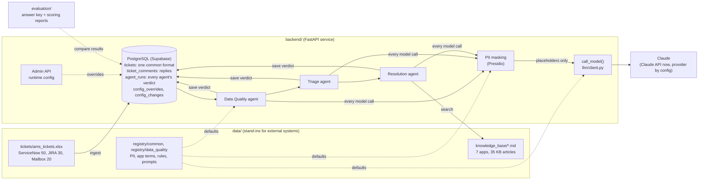

# AMS Agentic Incident Management

Agent pipeline for Application Management Services (AMS). Tickets arrive from ServiceNow, JIRA and support mailboxes and pass through three agents:

1. **Data Quality agent**: checks the ticket has enough information to act on. If not, it stops the ticket and drafts an email to the reporter asking for what is missing.
2. **Triage agent**: re-assesses priority against the company rulebook, regardless of what the reporter selected (a "P1" profile-photo issue is really a P5).
3. **Resolution agent**: finds the matching article in the application's knowledge base and proposes resolution steps.

This repository is a personal-environment skeleton: the source systems (ServiceNow, JIRA, mailboxes, Confluence) are replaced by local files.

## How it fits together



## Repository layout

```text
.
├── backend/               # FastAPI service: ingestion, database, agents, model access, admin (see backend/README.md)
├── frontend/              # Next.js 16 (App Router) + shadcn/ui dashboard (see frontend/DEVELOPMENT.md)
├── data/                  # Stand-ins for external systems, mounted read-only into the backend
│   ├── tickets/           #   servicenow_tickets.xlsx (DB schema) and ams_tickets.xlsx (JIRA, Mailbox)
│   ├── rules/             #   dq_rules.xlsx: sample Data Quality rules (dq_rules table schema)
│   ├── knowledge_base/    #   One Confluence-style page per application
│   └── registry/          #   Editable rules, application terms, PII settings and prompts; admin can override them at runtime
├── evaluation/            # Answer key and scoring reports; never read by the pipeline
├── docker-compose.yml
└── README.md
```

## Data

### Tickets

| File / sheet | Rows | Format |
|---|---|---|
| `servicenow_tickets.xlsx` | 80 | Same columns as the `servicenow_tickets` table: ticket_id, caller, short / full description, priority, assignment group, service, resolution notes, opened / closed. 50 regular tickets plus 30 edge cases ("I cant login", empty, "N/A", test, attachment only, missing caller or service, log dump, PII-rich, ...) |
| `ams_tickets.xlsx` → JIRA | 30 | AMS-xxxx keys, Highest..Lowest priority, application as *component* |
| `ams_tickets.xlsx` → Mailbox | 20 | Raw emails: sender, subject, body, attachments; no priority or application field |

Tickets from August to mid-October 2026 are closed and include resolution notes (reference history). Tickets from 19–26 October 2026 are open and untriaged; these are what the pipeline processes.

### Data Quality rules: `data/rules/dq_rules.xlsx`

18 sample rules in the `dq_rules` table schema, covering all ten operators, global and source- or service-bound rules, every `apply_to` value, one disabled and one soft-deleted rule. The `Operator_Semantics` sheet defines how each operator treats case, blanks and length. `evaluation/servicenow_dq_expected.xlsx` lists, per ticket, which rules should match when applied to existing and to new tickets.

### Knowledge base: `data/knowledge_base/`

One page per application with owner, support group, criticality tier, tech stack, and five known issues (symptoms, error codes, root cause, resolution steps, escalation):

| Application | File | Tier |
|---|---|---|
| PayrollPro | payrollpro.md | 1 |
| OrderHub | orderhub.md | 1 |
| SalesConnect CRM | salesconnect_crm.md | 2 |
| EmployeePortal | employeeportal.md | 2 (SSO = 1) |
| StockSense | stocksense.md | 1 |
| BillingEngine | billingengine.md | 1 |
| InsightBI | insightbi.md | 3 |

Known-issue tickets are built from these articles (same symptoms and error codes), so the Resolution agent always has a correct answer to find.

### Evaluation: `evaluation/ground_truth.xlsx`

The expected outcome for every ticket: whether it should pass Data Quality, what information is missing, the correct priority, the application and the KB article. It is used only to score the agents and is kept out of `data/` so the pipeline can never read it.

| Scenario | Count | Tests |
|---|---|---|
| complete | 62 | Happy path through all three agents |
| incomplete | 15 | Data Quality: should stop and email the reporter (3 borderline) |
| priority_mismatch | 10 | Triage: 7 over-prioritised, 3 under-prioritised by the reporter |
| no_kb_match | 10 | Resolution: no article applies (incl. out-of-scope and a feature request) |
| related_duplicate | 3 | One checkout outage reported 4 times across all sources |

## Backend

| Endpoint | Purpose |
|---|---|
| `POST /api/v1/ingest` | Load all three sources into the database. Safe to re-run: upserts and keeps agent results |
| `GET /api/v1/tickets` | List tickets, newest first. Filters: `source`, `status`, `application`, `pipeline_status`; paging with `limit` / `offset` |
| `GET /api/v1/tickets/{id}` | Full ticket with its original source row, replies and agent audit trail |
| `POST /api/v1/tickets/{id}/comments` | Add a reply. A reply from the reporter sends an `awaiting_info` ticket back to `pending` |
| `POST /api/v1/data-quality/run` | Check every pending ticket. Safe to re-run: unchanged tickets are skipped |
| `POST /api/v1/data-quality/tickets/{id}/check` | Check one pending ticket: rules, then the model if the rules cannot decide |
| `POST /api/v1/triage/run` | Recommend a priority for every `dq_passed` ticket. Safe to re-run: unchanged tickets are skipped |
| `POST /api/v1/triage/tickets/{id}/check` | Triage one `dq_passed` ticket: rules, then the model for the impact and any fact the rules lack |
| `GET /api/v1/triage/review-queue` | Triaged tickets waiting for an engineer, flagged ones first, with the recommendation and why |
| `POST /api/v1/triage/tickets/{id}/review` | Accept, edit or reject the recommendation (`accepted` / `edited` / `rejected`, with a reason code) |
| `GET /api/v1/triage/review-report` | How often engineers change the recommendation, by rule, stage and reason (`days`, default 7) |
| `GET /api/v1/triage/sla` | Open P1/P2 tickets (the engineer's priority, else the recommendation), most at risk first, each with its first-message draft (`at` sets the clock for demos) |
| `GET /api/v1/triage/tickets/{id}/first-message` | The first-message draft for one open P1/P2 ticket |
| `POST /api/v1/storms/run` | Find storms among the open tickets. Safe to re-run: existing storms are updated |
| `GET /api/v1/storms` | List storms (`status`: open, closed, declared) with their tickets |
| `POST /api/v1/storms/{id}/declare` | A person declares a major incident: records who and when, and is where the major-incident agent starts |
| `POST /api/v1/closure/run` | Score the close notes of every resolved ticket. Safe to re-run: unchanged notes are skipped (`include_history` also scores tickets that arrived closed) |
| `POST /api/v1/closure/tickets/{id}/check` | Score one resolved ticket's close notes: rules, then the model if the rules cannot stop them |
| `GET /api/v1/closure/queue` | Notes that need work, lowest score first, with the questions to ask and a draft built from what is on the ticket |
| `POST /api/v1/closure/tickets/{id}/review` | Accept the draft, edit the notes, or reject the check (with a reason code) |
| `GET /api/v1/closure/report` | Checks by verdict, why notes were stopped, and how often engineers rejected the check (`days`, default 7) |
| `/api/v1/admin/settings`, `/api/v1/admin/documents`, `/api/v1/admin/changes` | Change settings, rules, PII terms and prompts at runtime; change history. Needs `X-Admin-Key` |
| `GET /api/v1/health` | Liveness check |

During ingestion every source is mapped to one common ticket format. For example, ServiceNow `2 - High` and JIRA `High` both become `reported_priority = 2`. Open tickets get `pipeline_status = pending` and closed ones `historical`.

| Pipeline status | Meaning |
|---|---|
| `historical` | Closed reference ticket, never processed |
| `pending` | Waiting for the Data Quality check |
| `awaiting_info` | Information missing; chase email drafted |
| `dq_passed` | Good enough, ready for Triage |
| `triaged` | Priority recommended, waiting for an engineer |
| `reviewed` | An engineer decided the priority; ready for Resolution |
| `rejected` | Not a real ticket, e.g. a test |
| `error` | Failed in a way that needs a person to look |

The Data Quality rules stage (no model) stops only tickets it is certain about: test tickets become `rejected`; placeholder descriptions ("n/a", "tbd") and near-empty ones become `awaiting_info`. Everything else stays `pending` for the model step. Thresholds and terms live in `data/registry/` and are scored with `python evaluation/dq_rules_report.py`.

The Data Quality model step asks Claude one question about each ticket the rules left undecided: is it complete enough to work on? It is told what the rules already found (the application, even when the source has no application field, and whether the text holds a specific code or ID), and the prompt sets the bar: a specific symptom and an identifiable application are enough; when, who and steps are optional. The answer is `passed` (`dq_passed`) or `needs_info` with what is missing and a draft chase email (`awaiting_info`); the email is never sent automatically. Every agent calls the model through one function, `call_model()` in `backend/app/llm/client.py`. Model calls are off until `LLM_ENABLED=true`. The prompt lives in `data/registry/prompts.yaml`. Settings, rules, PII terms and prompts can be changed at runtime through the admin API, with no restart; see [backend/README.md](backend/README.md#configuration-and-admin).

The Triage agent recommends a priority from the rulebook in `data/registry/triage_rules.yaml` and the batch-job list in `jobs.yaml`, both built from the knowledge base. Each application has its own rules (symptoms, error codes, job names) with the priority its KB page gives, when to raise it (wider impact, a calendar window such as the payroll window or month-end close, business context such as a customer meeting) and the facts it `needs`. Generic rules (outage, slow, cosmetic, request) cover the rest by impact × urgency and the application's tier; then the application's ceiling; then the must-follow rules, which no ceiling can cap: security, a critical job failing in its window, checkout down, SSO down for many, salary late in the payroll window (all P1), and a cosmetic portal issue (P5). The reporter's own urgency words are ignored.

The rules settle a ticket only when every fact its rule needs is known and changes the answer; otherwise the model is asked once, with the facts the code found. It reports the rule, how many are affected and the business context, each with an exact quote from the ticket; a fact whose quote is not in the ticket goes back to unknown. The code then calculates the priority, so it always follows the rulebook. Without a usable model answer (switched off, or down) the rules' own answer is used, and an unknown fact leans high only when it could make the ticket P1/P2. The reporter's priority is never changed: the recommendation is stored in `agent_runs`, and a lowered P1/P2, a lean-high guess or a difference of more than two levels is flagged for review. A change to the rulebook re-triages every ticket. An engineer then accepts, edits or rejects each recommendation; the decision is stored separately in `agent_reviews`, next to the recommendation, and nothing is written back to ServiceNow or JIRA. The review report shows where engineers disagree with the agent, which is where the rulebook needs fixing. Scored with `python evaluation/triage_report.py`, on a tuning set and on held-out ServiceNow tickets.

**Storms.** Open tickets that report the same issue at once become a storm: the same application, opened within `window_min` of each other, sharing a known issue (one of the application's rules, or a failed batch job) or very similar text; login problems also group across applications. It becomes a storm at `people_needed` different reporters (`data/registry/storms.yaml`, provisional, per-application overrides possible). One main ticket (the failed job if there is one, else the first) is triaged, always P1 through the `storm` must-follow rule; the others follow its priority with no model call of their own. Grouping runs over the open tickets at the start of each Triage run, so it does not have to happen the moment a ticket arrives. A person can declare a storm a major incident; that only records who and when. The major-incident agent itself (who to call, bridge, updates, closure notes) is not built.

**SLA risk and the first message.** For open P1/P2 tickets `GET /api/v1/triage/sla` shows how much of the SLA target is used (`ok`, `watch` at 50%, `breach_likely` at 80%, `breached`) and a first-message draft written from a template in `data/registry/sla.yaml` (provisional: P2 = 8 h, P1 = 4 h is an assumption). The draft names the application and the problem in the rulebook's words, never a person, and a person sends it. Nothing is sent or scheduled by the system; a scheduler or a screen polls the endpoint.

**Closure Quality** scores the close notes of a resolved ticket, so the team can learn from them. Rules in `data/registry/closure_rules.yaml` stop what they are sure of: empty notes, filler like "done" or "N/A", notes under 40 characters, and notes that only repeat the problem. A test ticket is skipped. The rules never pass a note. For the rest the model reports three things, each with an exact quote from the notes: what caused the problem, what was done, and how it was checked (none, vague or specific). The code drops any level without a real quote, adds up a score out of 6 and applies the pass rule (provisionally: the action at least vague and a total of at least 4). A note that cites a knowledge-base article that exists ("Followed KB-BI-003") and says specifically what was done gets credit for the cause, because the article documents it; a switch in the rules file turns that off. A note that needs work gets one to three short questions for the engineer and a draft built only from facts on the ticket, with gaps marked `[engineer to add: cause]`; a draft containing a code or number found nowhere on the ticket is dropped. The engineer accepts a draft that has no gaps, edits, or rejects the check. The ticket's own notes are never changed and nothing is written back to ServiceNow or JIRA; the engineer's final notes are stored in `agent_reviews.final_text`. Nothing blocks a close. Scored with `python evaluation/closure_report.py [--model]` against 32 labelled cases (`evaluation/closure_cases.xlsx`, written by us, the support lead should confirm the labels) and the real notes in the sample data.

Personal information is masked with Microsoft Presidio before any text reaches a model: names, emails, phones, employee IDs, PAN, Aadhaar, bank accounts and cards become numbered placeholders such as `<PERSON_1>`, and the real values are put back into the model's answer locally. Application names, error codes, record IDs, sites and dates stay readable. The database keeps the original data. `python backend/scripts/mask_servicenow_tickets.py` writes `data/tickets/servicenow_tickets_masked.xlsx`, with the same person getting the same placeholder across the file. `python evaluation/pii_leak_report.py` checks that no known name or email survives.

## Quick start

With Docker:

```bash
docker compose up --build
curl -X POST http://localhost:8000/api/v1/ingest
```

Without Docker:

```bash
cd backend
python -m venv .venv
.venv\Scripts\activate             # macOS/Linux: source .venv/bin/activate
pip install -r requirements-dev.txt
cp .env.example .env
uvicorn app.main:app --reload --port 8000
```

Then open the API docs at http://localhost:8000/api/v1/docs, run `POST /ingest`, and browse `/tickets`.

Tests: `cd backend && pytest`

Set `DATABASE_URL` in `backend/.env` (Supabase, `postgresql+asyncpg://...`); never commit it. Table scripts are in `backend/db/scripts/`.

## Status

| Step | State |
|---|---|
| Dummy data: tickets, knowledge base, ground truth | Done |
| Ingestion, common ticket model, ticket API | Done |
| PostgreSQL (Supabase) async connection, DB scripts, frontend template | Done |
| Data Quality: rules stage, statuses, replies | Done |
| PII masking (Presidio): personal information only; masked ServiceNow export | Done |
| Data Quality: model check, "missing information" email draft | Done; scored live (`python evaluation/dq_rules_report.py --model`): 35/35 on the sample tickets and 16/16 on 16 borderline cases, on both Sonnet and Opus. Small sets, written by us; the support lead should confirm the labels |
| Model client (`call_model`), provider switch, kill switch | Done |
| Admin API: runtime settings, rules, PII terms, prompts, change history | Done (shared key; real logins planned) |
| Priority rulebook + Triage agent: rules per application, model step (Sonnet 5.5) | Done; scored live |
| Engineer review of Triage: queue, accept / edit / reject, agreement report | Done (reviewer not verified until there are logins) |
| Storm grouping, P1 for the main ticket, declare a major incident | Done, on synthetic tickets; thresholds provisional |
| SLA risk and P1/P2 first-message draft | Done; targets provisional; no sending or reminders yet |
| Major-incident agent (who to call, bridge, updates, closure notes) | Planned; needs an on-call roster |
| Closure Quality: rules, model score with quote checks, questions and draft, engineer review | Done; scored live: 10/10 good and 11/11 vague cases, 33/33 real notes, on Sonnet. Cases written by us; thresholds provisional |
| Knowledge Builder (save cases, match to the KB, draft articles, repeat issues) | Planned; see `architectures/closure-quality-knowledge-builder.html` |
| Resolution agent over the knowledge base | Planned |
| Chat UI (`frontend/`) | Planned |
| Scoring reports: Data Quality rules, PII leaks, Triage rules | Done |
| Scoring for the model steps and Resolution | Planned |
