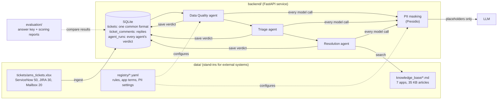

# AMS Agentic Incident Management

Agent pipeline for Application Management Services (AMS). Tickets arrive from ServiceNow, JIRA and support mailboxes and pass through three agents:

1. **Data Quality agent**: checks the ticket has enough information to act on. If not, it stops the ticket and drafts an email to the reporter asking for what is missing.
2. **Triage agent**: re-assesses priority against the company rulebook, regardless of what the reporter selected (a "P1" profile-photo issue is really a P5).
3. **Resolution agent**: finds the matching article in the application's knowledge base and proposes resolution steps.

This repository is a personal-environment skeleton: the source systems (ServiceNow, JIRA, mailboxes, Confluence) are replaced by local files.

## How it fits together



## Repository layout

```text
.
├── backend/               # FastAPI service: ingestion, database, agents (see backend/README.md)
├── data/                  # Stand-ins for external systems, mounted read-only into the backend
│   ├── tickets/           #   ServiceNow, JIRA and Mailbox export
│   ├── knowledge_base/    #   One Confluence-style page per application
│   └── registry/          #   Editable rules, application terms and PII settings used by the agents
├── evaluation/            # Answer key and scoring reports; never read by the pipeline
├── docker-compose.yml
└── README.md
```

## Data

### Tickets: `data/tickets/ams_tickets.xlsx`

100 tickets, one sheet per source, each in that system's native format:

| Sheet | Rows | Format |
|---|---|---|
| ServiceNow | 50 | INC numbers, caller, impact / urgency / priority, state, close notes |
| JIRA | 30 | AMS-xxxx keys, Highest..Lowest priority, application as *component* |
| Mailbox | 20 | Raw emails: sender, subject, body, attachments; no priority or application field |
| Data_Dictionary | — | Field meanings |

Tickets from August to mid-October 2026 are closed and include resolution notes (reference history). Tickets from 19–26 October 2026 are open and untriaged; these are what the pipeline processes.

### Knowledge base: `data/knowledge_base/`

One page per application with owner, support group, criticality tier, tech stack, and five known issues (symptoms, error codes, root cause, resolution steps, escalation):

| Application | File | Tier |
|---|---|---|
| PayrollPro | payrollpro.md | 1 |
| OrderHub | orderhub.md | 1 |
| SalesConnect CRM | salesconnect_crm.md | 2 |
| EmployeePortal | employeeportal.md | 2 (SSO = 1) |
| StockSense | stocksense.md | 1 |
| BillingEngine | billingengine.md | 1 |
| InsightBI | insightbi.md | 3 |

Known-issue tickets are built from these articles (same symptoms and error codes), so the Resolution agent always has a correct answer to find.

### Evaluation: `evaluation/ground_truth.xlsx`

The expected outcome for every ticket: whether it should pass Data Quality, what information is missing, the correct priority, the application and the KB article. It is used only to score the agents and is kept out of `data/` so the pipeline can never read it.

| Scenario | Count | Tests |
|---|---|---|
| complete | 62 | Happy path through all three agents |
| incomplete | 15 | Data Quality: should stop and email the reporter (3 borderline) |
| priority_mismatch | 10 | Triage: 7 over-prioritised, 3 under-prioritised by the reporter |
| no_kb_match | 10 | Resolution: no article applies (incl. out-of-scope and a feature request) |
| related_duplicate | 3 | One checkout outage reported 4 times across all sources |

## Backend

| Endpoint | Purpose |
|---|---|
| `POST /api/v1/ingest` | Load all three sources into the database. Safe to re-run: upserts and keeps agent results |
| `GET /api/v1/tickets` | List tickets, newest first. Filters: `source`, `status`, `application`, `pipeline_status`; paging with `limit` / `offset` |
| `GET /api/v1/tickets/{id}` | Full ticket with its original source row, replies and agent audit trail |
| `POST /api/v1/tickets/{id}/comments` | Add a reply. A reply from the reporter sends an `awaiting_info` ticket back to `pending` |
| `POST /api/v1/data-quality/run` | Check every pending ticket. Safe to re-run: unchanged tickets are skipped |
| `GET /api/v1/health` | Liveness check |

During ingestion every source is mapped to one common ticket format. For example, ServiceNow `2 - High` and JIRA `High` both become `reported_priority = 2`. Open tickets get `pipeline_status = pending` and closed ones `historical`.

| Pipeline status | Meaning |
|---|---|
| `historical` | Closed reference ticket, never processed |
| `pending` | Waiting for the Data Quality check |
| `awaiting_info` | Information missing; chase email drafted |
| `dq_passed` | Good enough, ready for Triage |
| `rejected` | Not a real ticket, e.g. a test |
| `error` | Failed in a way that needs a person to look |

The Data Quality rules stage (no model) stops only tickets it is certain about: test tickets become `rejected`; placeholder descriptions ("n/a", "tbd") and near-empty ones become `awaiting_info`. Everything else stays `pending` for the model step. Thresholds and terms live in `data/registry/` and are scored with `python evaluation/dq_rules_report.py`.

Before any text reaches a model it is masked with Microsoft Presidio: names, emails, phones, employee IDs, sites, application names, error codes and internal hosts become numbered placeholders such as `<PERSON_1>` or `<APP_1>`, and the real values are put back into the model's answer locally. The database keeps the original data. `python evaluation/pii_leak_report.py` checks that no known name, email or application survives on any ticket.

## Quick start

With Docker:

```bash
docker compose up --build
curl -X POST http://localhost:8000/api/v1/ingest
```

Without Docker:

```bash
cd backend
python -m venv .venv
.venv\Scripts\activate             # macOS/Linux: source .venv/bin/activate
pip install -r requirements-dev.txt
cp .env.example .env
uvicorn app.main:app --reload --port 8000
```

Then open the API docs at http://localhost:8000/api/v1/docs, run `POST /ingest`, and browse `/tickets`.

Tests: `cd backend && pytest`

There are no database migrations yet. After a model change, delete `backend/ams.db` (Docker: `docker compose down -v`) and run `POST /ingest` again.

## Status

| Step | State |
|---|---|
| Dummy data: tickets, knowledge base, ground truth | Done |
| Ingestion, common ticket model, SQLite, ticket API | Done |
| Data Quality: rules stage, statuses, replies | Done |
| PII masking (Presidio): people, contacts, IDs, sites, app names, codes, hosts | Done |
| Data Quality: model check, "missing information" email draft | Next |
| Priority rulebook + Triage agent | Planned |
| Resolution agent over the knowledge base | Planned |
| Chat UI (`frontend/`) | Planned |
| Scoring reports: Data Quality rules, PII leaks | Done |
| Scoring for the model step, Triage and Resolution | Planned |
